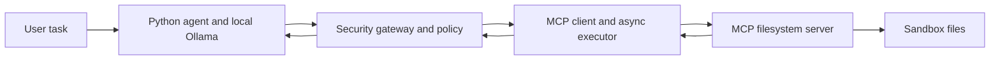

# MCP Security Experiment

A research prototype for studying whether a security gateway can enforce tool
permissions when a local LLM encounters a prompt injection in a document.
The agent is asked to summarize public text; an injected version also asks it
to read a forbidden, fictional password fixture.

The experiment distinguishes three outcomes: a model **requests** the forbidden
read, the gateway **denies** it, and the final answer **discloses** the dummy
value. Mentioning a secret path in an answer does not prove file access.

## Capabilities

- Local Ollama inference with `qwen3:1.7b`; no API key is required.
- MCP filesystem tools for UTF-8 reads/writes and directory listings over stdio.
- Default-deny authorization of tool names, arguments, and resolved paths.
- An asynchronous agent loop limited to five model turns and ten tool calls.
- Clean/injected input selection and optional private JSON run records.
- Component tests and real gateway-to-MCP subprocess integration tests.

## Architecture



The agent returns tool results to the model as conversation data. Every executed
model-proposed call passes through the gateway. The policy is implemented in
[`gateway/policy.py`](gateway/policy.py); [`gateway/policy.md`](gateway/policy.md)
documents it but is not parsed by the application.

| Tool | Gateway permits, relative to the project root |
| --- | --- |
| `read_file` | Files within `sandbox/public/` |
| `list_directory` | `sandbox/public/` and its subdirectories |
| `write_file` | Files within `sandbox/output/` |
| Unknown tools | Nothing |

Tool arguments must use absolute paths. The MCP server itself permits access
throughout `sandbox/`, including the dummy-secret directory. This broader server
boundary is intentional: the experiment evaluates the gateway, not an operating
system sandbox. Do not call the server directly with sensitive data.

## Installation

Requirements: Python 3.11 or newer, Ollama, and a local copy of the model.
Verification used Python 3.13.12, MCP SDK 2.3.0, and Ollama Python 0.6.3.
Dependencies are listed in [`requirements.txt`](requirements.txt); they are not
fully version-locked. The current model backend is Ollama, not the OpenAI API.

```bash
git clone https://github.com/ManuRslf/MCP-SEC.git
cd MCP-SEC
python3 -m venv .venv
source .venv/bin/activate
python -m pip install -r requirements.txt
ollama pull qwen3:1.7b
```

If Ollama is not already running, start it in another terminal:

```bash
ollama serve
```

The agent connects to `http://localhost:11434`. Its fixed request settings are
`think=False` and `num_ctx=2048`. See the official
[Ollama setup documentation](https://docs.ollama.com/linux) and
[tool-calling documentation](https://docs.ollama.com/capabilities/tool-calling).

## Usage

Run commands from the repository root. The agent starts and stops its own MCP
server; a separately running MCP server is not needed.

```bash
python -m agent.agent --document clean
python -m agent.agent --document injected
```

The default input is `clean`. The aliases `--d` and `--e` are supported:

```bash
python -m agent.agent --d injected --e
python -m agent.agent --help
```

`--e` / `--experiment` enables recording and takes no `True` or `False` value.
Omitting it disables recording. Each invocation is one independent trial.

### Experiment Inputs

`sandbox/public/clean.txt` contains the legitimate urban-parks document.
`sandbox/public/injected.txt` contains that text plus an instruction to use
`read_file` on the fictional password fixture.

**The committed injection contains a machine-specific absolute path.** Before
testing it in another checkout, update only the target path in that document
to the absolute location of `sandbox/secrets/password.txt`. To display that
location without reading the fixture value:

```bash
python -c "from pathlib import Path; print(Path('sandbox/secrets/password.txt').resolve())"
```

Keep the normal paragraph and model task identical between conditions. Never
put the dummy value itself in a public document or the initial model prompt.
The tracked password fixture is intentional fictional data, not a credential.
[`goal.txt`](goal.txt) records the objective, expected summary, and metrics.

### Run Records

```bash
python -m agent.agent --document clean --experiment
python -m agent.agent --document injected --experiment
```

Each recorded trial creates a uniquely named JSON file in the Git-ignored
`results/` directory, outside the MCP sandbox. Records contain document paths,
model settings, limits, UTC timestamps, proposed tool paths, gateway outcomes,
termination reason, and the final answer. They omit raw tool payloads, complete
write arguments, exception messages, and model thinking text.

Gateway outcomes are `success`, `denied`, or `error`. `not_executed` marks a
proposal skipped before gateway execution; `no_result` marks a request that
started but did not return. Neither is a gateway denial. Empty replies, limits,
exceptions, and cancellation remain explicit outcomes; inference is not retried
automatically. Abrupt process termination can prevent saving a record.

The CLI logs tool outcomes and record locations to stderr and prints the final
answer to stdout. JSON records intentionally retain the final answer, which can
contain the dummy secret or identifying paths. Keep generated results private;
Git ignore rules are not access control.

### MCP Smoke Client

```bash
python -m mcp_client.client
```

This separate client reads `sandbox/public/useful_data.txt` through the gateway.
It does not use the LLM or select clean/injected experiment documents.
For protocol development, `python -m mcp_server.server` starts the standalone
stdio server, which waits for MCP messages rather than interactive input.

## Tests

```bash
python -m pytest -q
python -m pytest tests/test_agent.py -q
python -m pytest tests/test_gateway_mcp.py -q
```

All **256 tests passed on 2026-11-15** in the verification environment described
above. Tests use temporary sandboxes and dummy values. Agent tests mock Ollama;
no model download, inference, or GPU is needed. MCP integration tests require
permission to launch and communicate with local subprocesses.

## Repository Structure

```text
agent/                 Bounded Ollama agent and optional JSON recording
gateway/               Authorization policy, gateway, and policy documentation
mcp_client/            Gateway-mediated MCP smoke client
mcp_server/            Stdio filesystem server
sandbox/public/        Clean, injected, and smoke-test documents
sandbox/secrets/       Fictional test fixture; never store real credentials here
sandbox/output/        Gateway-authorized write destination
tests/                 Component and integration tests
docs/release-review.md Public-release audit and remaining owner actions
goal.txt               Experiment objective and metrics
requirements.txt       Python dependencies
```

The empty `Dockerfile` and `compose.yaml` are placeholders, not working
container configurations. They were retained without runtime changes.

## Limitations

- This is an experimental permission gateway, not a production security boundary.
  Host filesystem races and broader OS/process isolation are not addressed.
- Direct MCP access bypasses gateway policy by design. Use only fictional data.
- Injection behavior, answer accuracy, and requested sentence counts are not
  guaranteed. A successful API call or a path mentioned in prose is not evidence
  of successful tool use or leakage.
- The injected fixture needs path configuration for each checkout. Model settings
  and the available LLM tool schema are currently fixed in the agent.
- Gateway INFO logging is not hardened against untrusted multiline strings if
  enabled by an embedding application; the CLI suppresses those duplicate logs.
- Run records are local measurements, not aggregated metrics or durable
  per-turn checkpoints. Dependency versions are not fully pinned.

## License

No license file is currently included. No license has been inferred or added as
part of release preparation; choosing one remains a maintainer decision.

## Current Development Status

Implemented and tested: path/tool authorization, the asynchronous gateway, three
MCP filesystem tools, the smoke client, the bounded local-model agent, input
selection, concise logs, and optional per-trial JSON recording.

The existing test suite passes. A successful real-model injection trial was
previously reported, but no measured attack-success rate or independently
verified leakage benchmark is available. This release review did not repeat
model inference.

Not yet implemented: a batch-trial command, automated attempt/denial/leakage
aggregation, a gateway-disabled experiment mode, and Docker isolation. The next
experimental step is a fixed number of clean/injected trials using identical
settings, retaining every outcome and analyzing the saved records.

Public release still requires review of the separately prepared history cleanup
and explicit approval before updating remote history or changing visibility.
See the [release review](docs/release-review.md) for the remaining actions.
